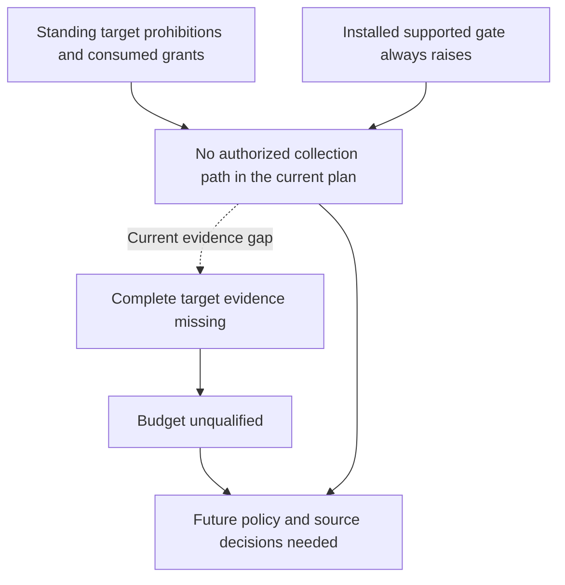

# Evidence and admission policy: local decision brief

**Recommendation for a future policy decision: treat evidence-collection
admission and research/training admission separately. Current permissions,
source code, limits and the closed gate remain unchanged.** This brief is not
an operational scope, collection design, approval request or permission to run.

See the [review-only decision](../configs/predictor_pgd_evidence_policy_review_v1.json)
and [saved audit review](../report/checks/2026-11-25-pgd-evidence-policy-review-v1-local-review.md).
The user accepted a LOCAL review of the evidence/admission dependencies. That
acceptance supplies no remote authority. The tree was clean at pushed commit
`655b2a7e0b4b2a287f34e23d1293cdd239db39c2`; no agent Git mutation occurs here.

## Four separate barriers

| Barrier | Current finding | What it means |
| --- | --- | --- |
| Evidence | Complete current-workload timing, overhead and peak-memory evidence is missing. | No qualified budget solution is established. Local fake checks and partial historical timings cannot supply it. |
| Authority | Standing instructions prohibit new target queries/runs/operational requests and state all real grants consumed. | Read-only queries have no automatic exemption. Permission for this local review is not permission to collect target data. |
| Implementation | The supported installed v5 `run` calls a budget function whose only statement raises. | It refuses before delegate protocol clock, ATTEMPT or process effects. New evidence JSON or different policy wording cannot open this implementation. |
| Qualification | Evidence validity and full research/training qualification remain separate obligations. | Even future permission to gather evidence would not qualify that evidence, its performance claims or training. |

The important dependency is in the current permitted workflow. It is not proof
that every workload or future design is infeasible, nor a claim that all possible
Python invocations are physically blocked. A captured private delegate exists in
source; using it or an older helper to bypass the supported gate is not authorized.

This diagram describes dependencies, not an executable state machine, runtime
cycle, schedule or alternative route. The gate does not read this report. A
policy change alone cannot change its code; changing code alone cannot supply
authority. Supplying measurements alone cannot open the installed client.

## What the existing evidence establishes

The historical v3 attempt is consumed and its saved session failed/incomplete,
with only proof in completed roles and unconfirmed owned-child exit in the saved
error. The genuine full storage proof and31 original gradient completions remain
genuine. Whole units remain0; candidate/replay did not start. No failure, partial,
pending, transport or consumed record is rewritten, promoted or demoted. Current
remote process state and the lost primary trigger remain unproved.

That old runtime47/450548B differs from current phase48/481518B. Phase accounting
and reader bindings have local fake validation; current phase target execution
and complete measured envelopes are not established. Old context endpoints omit
their own publication/timer exit. Unrelated epochs cannot be subtracted and
nested spans cannot be added to invent a complete-unit duration.

The reviewed corpus lacks actual target binary/build/source/ABI/backend/provider
joins. A NEW exact already-saved artifact with those joins could advance that
provenance question after review. A generic release wheel/version string would
not identify deployed binaries. Provenance alone would still not prove physical
private capture, exact bytes/refusals, lifetime or complete-unit performance.
No new artifact is identified here; bounded prior absence findings are not
whole-machine absence claims. No inventory/source/proof/benchmark is repeated.

A NEW source-backed candidate and valid local proof/cost evidence could advance
candidate eligibility. Actual matched original/candidate/fresh replay evidence,
complete phase/parent envelopes, memory and recovery would still be required.
Economics, calibration, data/protocol, registry/study and financial/training holds
remain separate gates. Real compute must be recorded as real work even when a
future result is partial or training is not admitted; false admission flags do
not erase genuine work.

An older `next_separate_local_requirement` in the preserved budget JSON points
to deriving phase accounting, which has already been completed locally. It is
a historical pointer, not current authority to repeat that closed work. Its
original bytes remain unchanged. The latest standing restrictions and the
current supported source gate continue to apply.

## The next policy decision

The [nonoperative decision brief](../runs/pretrained/diagnostic/pgd-evidence-policy-review-v1-20261125/POLICY-DECISION-BRIEF-v1.json)
identifies four topics for a future explicit decision:

1. Whether future evidence gathering should have admission criteria distinct
   from research/training qualification.
2. How any future authority decision preserves consumed one-shot claims, with
   no reuse or retroactive authorization.
3. How any change to the supported workload implementation receives independent
   source review while preserving science, ownership, durability, clocks and caps.
4. How permission to collect evidence remains separate from judging evidence
   valid and from every subsequent qualification gate.

The recommendation is at policy level only. This review does not revise operative
instructions, choose a collector/API/route, design a target scope, create grant
material, request approval for a target action, emit a command or schedule a
query/prototype/benchmark/run. The present policy decision remains unresolved.
A future explicit instruction decision would be needed before designing an
operational evidence path; this brief cannot serve as that decision or as a
positive budget flag. Existing science, guards, timing boundaries and caps are
not proposed for relaxation. Any future collection permission would still leave
training closed until its own evidence and gates qualify.

## Validation and preservation

Twenty-five source/metadata/instruction-snapshot pins, six AST anchors, six source
range hashes and three policy range hashes support five evidence topics and four
barriers. Only source/AST/JSON/stat/hash work runs. The independent saved audit
checks71830 prior hashes/78043 prior fixture entries/zero new and all dependency,
history, source-lineage and nonoperative-decision joins. It invokes no analyzer,
inspected source/project/test/scientific callback, scientific-value decoder/
recalculation, fake port, process/clock/timer/GPU/proof/target/network operation.
Initial misspelled source-path lookups are retained and corrected; no code or
evidence is changed to fix them. All source/auditor versions/logs/results remain.

Device16777233 inherits the prior NEW v4 LSTAT record/review for conditional
LOCAL metadata only. Old29 refusal/records, target66307 gates and four exact
lifecycle directory exceptions remain. FIFO is LSTAT-only, never opened/read/
hashed. No mount probe/remap/waiver or physical-volume authentication is added.
Further device changes require another record/review. The seal excludes live
indexes and includes their exact before/after snapshots.

Graph56uploads936711B/runtime48files481518B/cache47/nine supervisors/270paths and
control `d997bf9ed74c8ebf4504a5e6214a35e28365f85e9da3d7738a5b58f5edaa9f29` stay fixed.
Immutable copies/EVERY fresh hash/ordered state_digest/science/native/ownership/
durability/shutdown/Guard and continuing clocks stay fixed. Objective120/unit720/
setup180/proof60/soft2280-hard2400/final120/collection600/connection3000/RSS4GiB/
allocator7GiB and all other caps remain. All grants consumed, maximum new real
attempts0, execution binding null, budget `REJECT_CURRENT_ROUTE_FOR_NEW_SCOPE`.
No scope/handoff/package/grant/approval request/launch, university query/SSH/
upload/retry/resume/retrieval/cleanup, target/GPU/proof/paid work or manual paste.
Mechanism closed/research-training false; all PGD/EOT/optimizer/registry/study
YAML/financial caps/holds remain. Historical financial snapshots are not current
quotes/balance. No training percentage/time estimate. Git mutations remain
express-request only; short numbered commit messages remain automatic.
